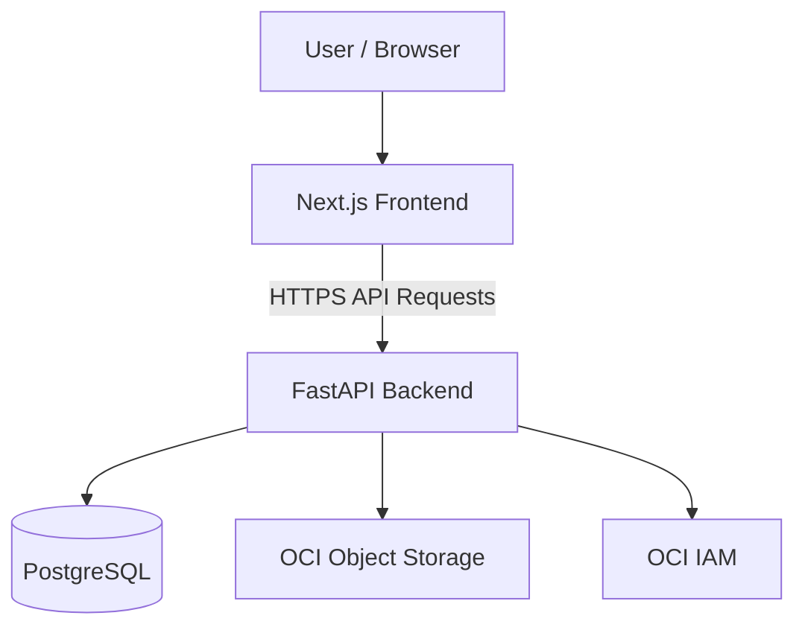

# Nuvora

**Secure Cloud-Native File Storage and Management Platform**

Nuvora is a cloud-native file storage and management platform designed to explore modern software engineering, cloud architecture, application security, and DevSecOps practices.

The platform is being developed with **Next.js, TypeScript, Python, FastAPI, PostgreSQL, and Oracle Cloud Infrastructure (OCI)**.

> **Project Status:** Initial development — architecture and foundations in progress.

## Project Goals

- Build a secure and scalable cloud-based file management platform.
- Apply production-oriented software engineering practices.
- Implement identity, authentication, and authorization securely.
- Automate cloud infrastructure using Infrastructure as Code.
- Establish automated testing, CI/CD, and security checks.
- Implement application observability and operational monitoring.

## Planned Features

- User registration and authentication
- Secure file upload and download
- File listing, search, rename, and deletion
- Folder and file organization
- User-level access control
- Storage usage dashboard
- Activity and audit logging
- Secure cloud object storage integration

*Features will be marked as implemented as development progresses.*

## Technology Stack

| Layer | Technology |
|---|---|
| Frontend | Next.js, React, TypeScript |
| UI | Tailwind CSS, shadcn/ui |
| Backend | Python, FastAPI, Pydantic |
| Database | PostgreSQL |
| ORM | SQLAlchemy |
| Database migrations | Alembic |
| Python tooling | uv, Ruff, Pytest |
| Cloud platform | Oracle Cloud Infrastructure |
| Object storage | OCI Object Storage |
| Infrastructure as Code | Terraform |
| CI/CD | GitHub Actions |
| Observability | OpenTelemetry, Prometheus, Grafana |
| Testing | Pytest, Playwright |

## High-Level Architecture



The frontend communicates with the backend through HTTPS APIs. The backend is responsible for authentication, authorization, metadata management, and secure object storage operations.

OCI credentials must never be exposed to the browser.

## Repository Structure

```text
nuvora/
├── .github/
│   └── workflows/
├── apps/
│   ├── web/
│   └── api/
├── docs/
│   ├── architecture/
│   ├── security/
│   └── decisions/
├── infrastructure/
│   └── terraform/
├── scripts/
├── tests/
├── .gitignore
├── LICENSE
└── README.md
```

## Security Principles

Security is a core design requirement.

- Least-privilege access control
- Private object storage
- Secure password hashing
- Server-side authorization
- Secrets management
- Input validation
- Secure file handling
- Dependency and container security scanning
- Audit logging
- HTTPS for application communication

No cloud credentials, API keys, passwords, or other secrets should be committed to this repository.

## Development Roadmap

- [ ] Repository and engineering foundations
- [ ] Architecture and security design
- [ ] Next.js frontend foundation
- [ ] FastAPI backend foundation
- [ ] Database integration
- [ ] Authentication and authorization
- [ ] OCI Object Storage integration
- [ ] Terraform infrastructure
- [ ] Automated testing and CI/CD
- [ ] Observability and monitoring
- [ ] Deployment and operational documentation

## Engineering Documentation

Project documentation will be maintained in the `docs/` directory.

- `docs/architecture/` — System architecture and technical designs
- `docs/security/` — Security architecture and threat models
- `docs/decisions/` — Architecture Decision Records (ADRs)

## License

This project is licensed under the MIT License. See [LICENSE](LICENSE) for details.

## Project Development

Nuvora is being developed as an engineering portfolio project focused on cloud-native application development, cloud security, infrastructure automation, and operational excellence.